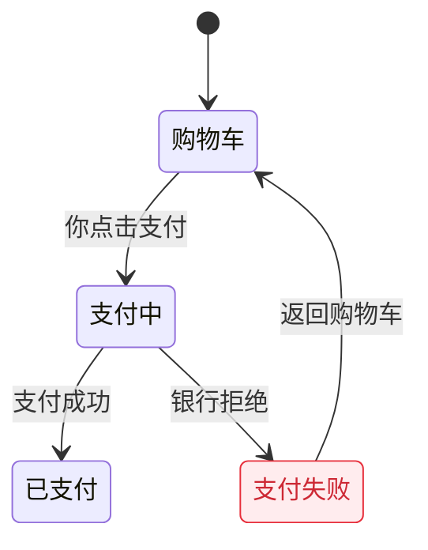

# Diagram (canvas)

A diagram is a plain Mermaid file: `name.mmd` (or `.mermaid`). Write only Mermaid text: no Markdown fences, no `%%{init}%%` block. The renderer is pele, which supports the common Mermaid diagrams (flowchart, stateDiagram-v2, sequenceDiagram, classDiagram, erDiagram, and more) and ignores Mermaid themes; canvas supplies the colors.

Invalid diagrams always report a line and column. If pele cannot locate the error, empty or unknown headers report `1:1`; diagram-size and edge-limit errors point at the diagram header line.

Node ids are limited to 200 UTF-16 code units so they remain usable as comment anchors; longer ids fail the check. Labels can be longer, but a comment stores only the first 500 code units and drift compares that same prefix, so changes beyond it are not reported.

## Make it readable

- Draw one question per chart. Aim for about 20 arrows or fewer; past that, split the chart or merge states that act the same.
- Label nodes and arrows in the reader's words: what they see or care about ("支付失败", "you press pay"), never function, variable or table names.
- Keep labels short, about 6 words or 12 Chinese characters. Put the detail in your reply, not on the chart.
- Give nodes short ids and put the words in the label: `pay[支付中]`, or `s3: 支付失败` in a state chart. Keep ids stable when you edit: the user's comments are pinned to ids, and earlier references point at them too.
- Pick the direction that matches the reading: `flowchart LR` for a sequence of steps, `flowchart TB` for a hierarchy or a long process.
- Quote labels that contain brackets, colons or quotes: `A["retry (3×)"]`.

## State charts

Follow the statechart conventions (pstack's `statechart` skill uses the same ones), so its charts render here unchanged:

- Use `stateDiagram-v2`, ids `s1`, `s2`, … and labels `s1: 购物车`. Start with `[*] --> s1`.
- Color each state by its phase with a group class: `class s1 teal`. Groups: `blue`, `orange`, `purple`, `yellow`, `teal`, `tan`, `pink`.
- Mark problems with these classes; canvas draws them in light and dark themes:
  - `breaks`: the state breaks a rule (red).
  - `mayBreak`: some model states behind it break a rule (orange).
  - `bugPath`: on the shortest path to a bug (blue border).
  - `repeats`: a counterexample repeats it forever (purple dashed border).
- Keep `classDef breaks fill:#ffecee,stroke:#e72e3b,color:#cd2834` and `classDef mayBreak fill:#fff3e6,stroke:#e8730c,color:#b85a06` in the file, so other Mermaid viewers also show the marks.

